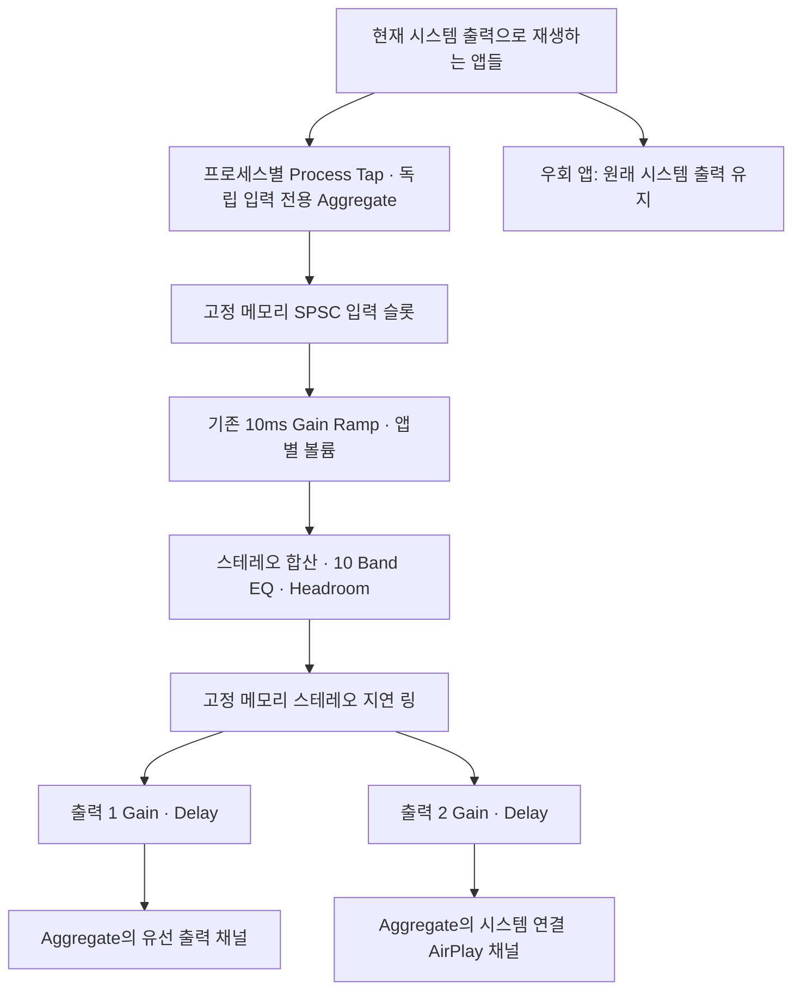

# Architecture

> Version 0.2.1 preserves the direct wired + one system AirPlay output and existing DSP. Independent input readers now feed the persistent physical output, so process discovery cannot reset its clock. No HLS, virtual-output driver, UI redesign or hardware-buffer-size change is part of this fix. See [AUDIO_DROPOUT_REPORT.md](AUDIO_DROPOUT_REPORT.md) for current measurements.

## 범위

Vanille는 Swift/AppKit/Core Audio로 구현합니다. 최소 macOS 15, arm64입니다. 프로세스 탭을 읽고, 앱별 Gain → Global EQ → 출력별 Gain/Delay 순서로 처리하여 여러 독립 스테레오 장치에 씁니다. 사설 Aggregate를 기본 시스템 출력으로 선택하지 않습니다. 캡처 가능한 일반 오디오가 대상이며 DRM 오디오의 처리를 보장하지 않습니다.

## 제어와 오디오 스레드

- `AppState`: 메인 스레드의 UI 상태·장치/프로세스 발견·설정 저장. HAL 변화와 잠자기/깨우기 알림을 수신합니다. 1초 주기 폴링으로 상태를 보완합니다.
- `AudioController`: 직렬 제어 큐에서 엔진 생성·중지·재구성을 직렬화합니다. 250ms 감시 타이머가 콜백 중단과 포맷 변화를 검사합니다.
- `AudioEngine`: 실제 목적지만 포함하는 사설 출력 Aggregate와 그 IOProc을 유지합니다. 출력 UID/Object ID/포맷이 달라지거나 사용자가 중지할 때만 출력 구성을 재생성합니다. 프로세스 목록과 테스트 음원 활성 상태는 출력 구성 키에 포함하지 않습니다.
- `ProcessCapture`: 프로세스 하나마다 고정 멤버십의 Process Tap, 입력 전용 사설 Aggregate와 IOProc을 소유합니다. 새 프로세스/Helper는 입력 리더만 추가하고, 종료/우회 시 해당 리더만 해제합니다. 다른 소스의 tap description을 변경하지 않습니다.
- `CaptureSlot`: 고정 크기 stereo SPSC 링으로 입력과 출력 IOProc을 연결합니다. 원자적 publication/소비 위치와 generation handshake를 사용합니다. 옛 producer가 종료되기 전에는 슬롯을 재사용하지 않습니다.
- `RenderContext`: 슬롯의 stereo PCM을 기존 앱 Gain/EQ/출력 mixer로 전달합니다. 콜백에서 파일/네트워크 I/O, UI 갱신, 메모리 할당, mutex 또는 문자열 로그를 사용하지 않습니다.
- `AudioDiagnostics`: 콜백은 host/sample timestamp와 gap/underrun 카운터를 원자적으로만 기록합니다. 제어 큐가 이를 수집해 bounded event history와 시스템 로그로 내보냅니다. 오디오 샘플은 로그에 포함하지 않습니다.

최대 32개 **프로세스 리더**와 8개의 스테레오 목적지를 처리합니다. Helper 리더의 Gain은 같은 논리적 앱의 Bundle ID 설정을 사용합니다. 제품 검증은 이 상한까지 수행하지 않았습니다. 출력별 지연 이력은 기존 공유 스테레오 링 하나에 저장합니다. 입력 슬롯의 용량 상한은 지연 목표가 아니며, 시작 시 실제 producer/output 콜백 중 큰 값 한 quantum만 위상 여유로 둡니다. 현재 입력 quantum은 512 frames/48kHz(약 10.7ms)입니다. 하드웨어 버퍼를 늘리지 않았고 장시간 누적 지연이나 절대 음향 지연은 별도 검증 대상입니다.

## 탭과 원본 출력

`CATapDescription(stereoMixdownOfProcesses:)`에 현재 시스템 출력 Device UID를 지정합니다. Helper는 바깥 앱 Bundle ID, 부모 프로세스, Bundle ID 접두사를 통해 묶습니다. Vanille 자신의 PID/Bundle ID는 캡처 목록에서 제외하여 피드백을 피합니다. Bundle ID가 없는 활성 프로세스는 명시적인 Other System Audio 그룹으로 묶습니다.

탭은 처음에는 `.unmuted`입니다. 해당 입력 리더와 출력 소비 양쪽에서 실제 비영(非零) 신호를 확인한 소스만 제어 큐에서 `.mutedWhenTapped`로 전환합니다. 짧은 소리를 폴링 사이에 놓치지 않도록 신호 수신 여부를 원자적으로 래치합니다. 권한 거부/초기 캡처 불가/지원하지 않는 포맷에서는 원본이 계속 재생됩니다. 정상적인 무음이나 다른 프로세스의 시작/종료는 전체 출력을 중지할 이유가 아닙니다.

`.mutedWhenTapped`는 리더가 중지되면 원본 출력을 복구하기 위한 공개 동작입니다. 입력 리더가 1.5초 이상 응답하지 않거나 버퍼 오류가 나면 해당 소스만 원본으로 복귀합니다. 출력 자체가 멈추거나 실제 출력 포맷이 바뀌면 전체 처리를 안전하게 중지합니다. HAL이 콜백과 Aggregate 해제를 모두 거부하면 그 메모리를 유지하고 슬롯 재사용을 차단합니다. 강제 종료/잠자기/서버 재시작의 모든 실패 조합은 별도 검증 대상입니다.

`kAudioHardwarePropertyDefaultOutputDevice`는 미디어 캡처/출력 경로이며 `kAudioHardwarePropertyDefaultSystemOutputDevice`는 시스템 효과음의 별도 기본값입니다. 후자는 관찰·기록하지만 그것만 달라져도 출력 세션을 재시작하지 않습니다. 현재 미디어 출력과 다른 장치에서 재생되는 효과음은 원래 경로를 유지하며 처리됐다고 표시하지 않습니다.

## Aggregate와 장치별 처리

Aggregate는 **비공개·비 stacked** 구성입니다. 각 실제 장치의 스테레오 채널을 독립적으로 유지하여 출력별 PCM Gain/Delay를 적용합니다. `kAudioAggregateDevicePropertyFullSubDeviceList` 순서, 활성 하위 장치 수, 입력/출력 채널 수, Float32 포맷과 Sample Rate를 검사합니다. 예기치 않은 레이아웃은 원본으로 복귀합니다. 물리 입력 스트림은 IOProc stream usage에서 끄므로 마이크 데이터를 읽지 않습니다.

가능하면 유선 장치를 출력 주 클록으로 정하고 나머지 하위 장치의 Core Audio Drift Compensation을 켭니다. 입력 전용 Aggregate에도 tap drift compensation을 지정합니다. 출력 Aggregate에는 탭이 없으므로 새 탭의 생성·mute 전환이 기존 출력/다른 입력의 클록을 재구성하지 않습니다. 하드웨어 Sample Rate를 강제로 쓰지 않습니다. 현재 입력은 출력과 같은 Sample Rate의 Float32 stereo만 허용하며 다르면 해당 소스를 원본으로 우회합니다. 자체 비동기 리샘플러를 새로 추가하지 않았습니다. 다른 sample rate 조합과 장시간 링 점유 드리프트의 검증이 필요합니다.

출력별 Volume/Mute는 PCM Gain이며 10ms ramp가 있습니다. Delay는 Sample Rate로 ms를 샘플 수로 변환한 실제 읽기 위치입니다. 변경 시 이전/새 위치를 30ms crossfade합니다. 크기가 다른 실제 장치 버퍼를 억지로 직접 연결하지 않고 Aggregate가 한 IO 타임라인을 제공하도록 합니다.

개발용 타이밍 음원은 렌더 스레드에서 생성한 1kHz/100ms 펄스이며 4초마다 반복합니다. 실제 출력별 Gain/Delay 경로를 검사하며 캡처 앱 없이도 실행할 수 있습니다. **제품 UI에서는 이 음원과 모든 수동 지연 조작을 제거했습니다.** 진단 빌드의 자동 검사만 이 내부 경로를 사용합니다. 진단 상태와 수동 파라미터 override는 저장되지 않습니다.

**클록 드리프트 보정과 실내 음향 동기화는 다릅니다.** AirPlay의 device latency와 safety offset은 0이지만, 추가 조사에서 **stream latency가 9840 frames / 48kHz = 205ms**인 것을 확인했습니다. DeviceManager는 기기 지연 + safety offset + 최대 출력 stream 지연을 합산합니다. AudioController는 매 reconcile에서 가장 느린 활성 장치를 기준으로 나머지 출력의 양의 Delay를 **자동 계산**합니다. 이 환경의 유선은 50+50 frames로 약 2.083ms여서 9740 samples, 약 **202.917ms**가 적용됩니다. 기존 파일에 남은 수동 Delay 값은 제품 경로에서 사용하지 않습니다.

1초 폴링과 HAL 알림으로 보고 지연의 변화를 반영하며, 파라미터 갱신은 같은 30ms crossfade 경로를 사용합니다. 보정값을 얻지 못하거나 3초를 넘는 다중 장치 조합은 처리하지 않고 원본을 유지합니다. 시스템 AirPlay 역할은 공개 연결이 하나일 때 그 연결을 따라가므로 세션별 UID 변화가 사용자 조작을 요구하지 않습니다. 여러 AirPlay endpoint가 나타나 역할이 모호하면 임의로 고르지 않습니다.

이것은 OS 보고 지연의 자동 보정이며 청취 위치의 음향 측정은 아닙니다. 네트워크 변동, 스피커 내부 처리와 방 안 거리의 영향을 모두 검증하지 않았으므로 완벽한 음향 동기화를 보증하지 않습니다. 최종 UI에는 보정 숫자나 수동 조작이 없습니다.

## DSP

Global EQ는 순수 Swift의 10개 peaking biquad 필터입니다. Apple 공개 PCM API와 수학 연산만 사용합니다. AVAudioEngine을 HAL 옆에 추가하지 않아 별도 렌더 클록과 스케줄러를 피합니다. UI 계수 계산은 제어 큐에서 수행하고, 세 개의 고정 슬롯을 가진 SPSC mailbox가 일관된 계수/게인/지연 스냅샷을 렌더에 전달합니다.

주파수는 32/64/125/250/500/1000/2000/4000/8000/16000Hz, Gain ±12dB입니다. Preamp는 −24…0dB입니다. Auto Headroom은 합산 필터 응답을 주파수 격자에서 계산해 최대 boost를 보상합니다. EQ 전환/계수는 부드럽게 바꾸며 최종 peak ceiling은 0.98입니다. 이 limiter는 mastering용 lookahead limiter가 아닙니다. EQ Off는 dry 경로이며 앱/출력 볼륨과 Delay는 계속 적용됩니다. 모든 처리를 해제하려면 Pause를 사용합니다.

## DRM

영상 캡처, ScreenCaptureKit, HDCP 처리, 복호화, 보호 콘텐츠 접근을 사용하지 않습니다. Music/TV는 기본 우회하고 사용자가 앱별 우회를 선택할 수 있습니다. 우회 앱은 탭 생성 대상에서 제거되어 본래 플레이어와 본래 출력 경로를 유지합니다.

보호 콘텐츠를 식별하는 공개 감지 기능을 구현하지 않았습니다. 초기 신호 확인은 DRM 판정이 아닙니다. 이미 탭이 활성화된 앱이 보호 콘텐츠로 전환되면 자동 복구가 보장되지 않으므로 브라우저/미디어 앱의 수동 우회가 필요합니다. 실제 서비스별 DRM 검증 내역은 TEST_REPORT에 따로 표시합니다.

## AirPlay 범위

공개 Core Audio 목록에 나타난 시스템 AirPlay 출력은 실제 Aggregate 대상으로 사용할 수 있습니다. 개별 네트워크 HomePod를 발견·연결하거나 두 페어를 시스템 HAL 장치 두 개로 여는 공개 경로는 이번 환경에서 찾지 못했습니다. AVRoutePickerView는 연결된 AVPlayer의 미디어를 위한 UI이며 일반 시스템 오디오의 다중 라우터로 사용하지 않습니다.

Apple 문서와 실행 결과는 [ROUTING_FEASIBILITY.md](ROUTING_FEASIBILITY.md)에 정리했습니다. 물리적으로 검증하지 못한 다중 AirPlay, 장시간 드리프트, 자동 연결 복구를 지원 완료로 표시하지 않습니다.

## 저장과 개인정보

`Application Support/Vanille/settings.json`에 Codable로 원자적으로 저장합니다. Bundle ID, Device UID, 출력 그룹·지연·볼륨, EQ, 프리셋, 프로필, 우회 앱과 일시 중지 상태를 포함합니다. 기존 스키마에는 기본 그룹을 보완하고 손상 파일은 안전한 기본값으로 복구합니다. 오디오 샘플은 메모리에서만 처리하며 네트워크 연결이나 계정은 없습니다.

## 공식 API 참고

- [Core Audio taps 예제](https://developer.apple.com/documentation/coreaudio/capturing-system-audio-with-core-audio-taps)
- [CATapDescription](https://developer.apple.com/documentation/coreaudio/catapdescription)
- [Multi-Output Device](https://support.apple.com/guide/audio-midi-setup/play-audio-through-multiple-devices-at-once-ams7c093f372/mac)
- [Aggregate 설정과 드리프트 보정](https://support.apple.com/guide/audio-midi-setup/set-aggregate-device-settings-ams094c7edb4/mac)
- [AVRoutePickerView.player](https://developer.apple.com/documentation/avkit/avroutepickerview/player)
